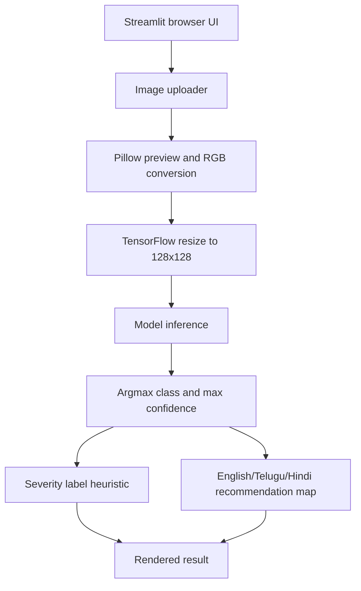

# Plant Disease Detector Architecture

## Overview

The application is a single-process Streamlit inference demo. It loads a
bundled TensorFlow/Keras model, accepts a leaf image from the browser, performs
fixed-size preprocessing, predicts a class, and renders a localized
recommendation.

## Components and data flow

- `main.py` defines the Streamlit page, language labels, class names,
  recommendations, severity display, and inference function.
- `load_model()` loads `trained_plant_disease_model.keras` through
  `st.cache_resource`, so the model is reused during the Streamlit process.
- `model_prediction()` loads the uploaded image at 128×128, converts it to an
  array, adds a batch dimension, and calls `model.predict()`.
- The highest-probability class index selects one entry from the embedded
  `class_names` list. The maximum probability is shown as confidence.
- The recommendation map is local code; there is no database or external API.
- The app does not write uploaded images or prediction history to a persistent
  application store.

## Security and operational boundaries

The application runs locally by default and has no authentication or remote
storage layer. Uploaded images are processed by the Streamlit process. A
public deployment would need explicit limits, privacy handling, model/license
review, and a clear user-facing disclaimer before accepting images from other
people.

## Limitations

The model's training data, class distribution, calibration, and evaluation
metrics are not documented in this repository. The severity label is a simple
class-name heuristic, not a calibrated disease-severity model. The result must
not be presented as a diagnosis or as a substitute for expert agricultural
advice.
